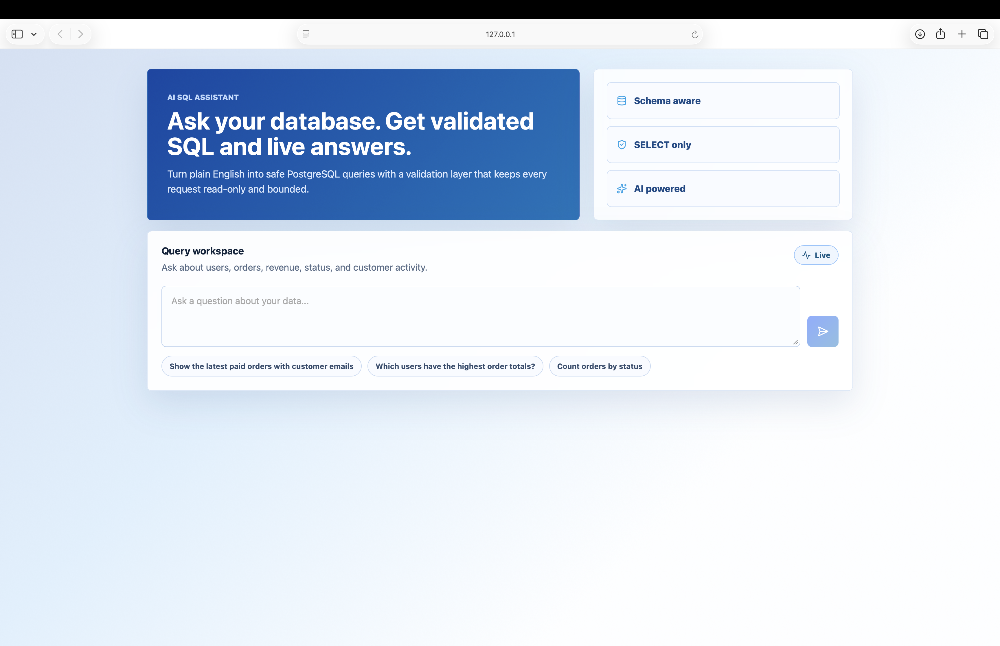
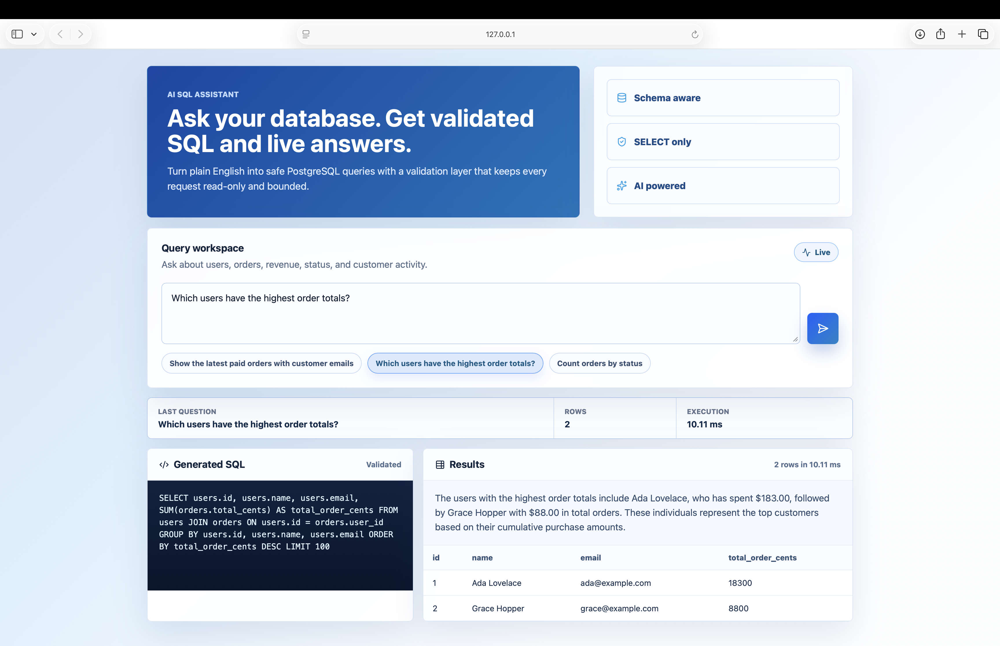
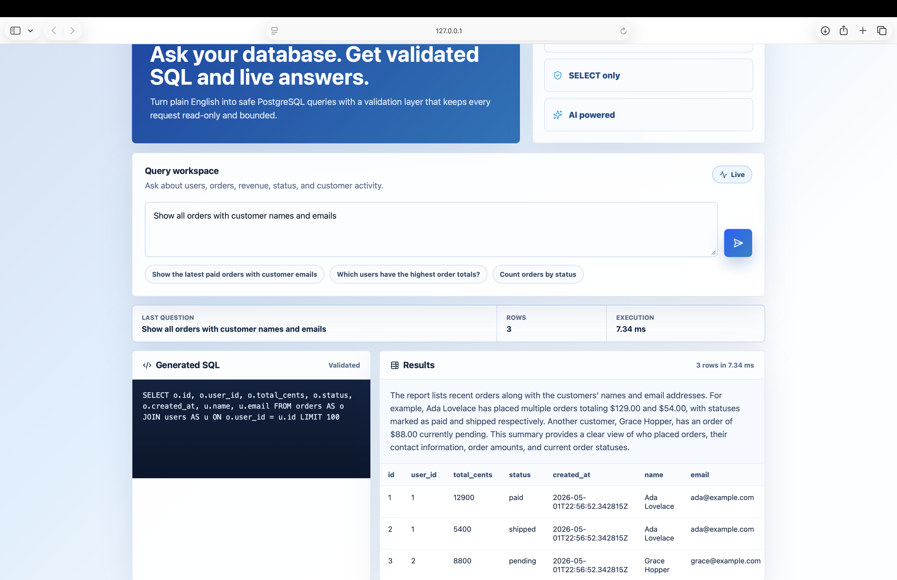
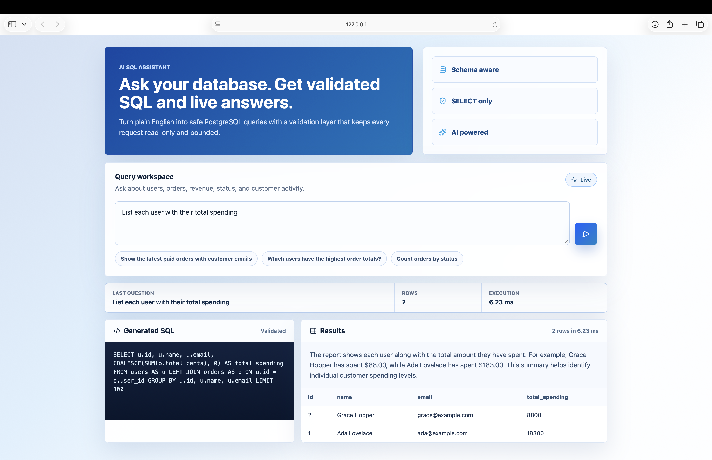

# AI SQL Assistant

A full-stack AI SQL assistant for asking natural-language questions against a PostgreSQL database.

The app turns a question into SQL, validates the generated query, runs it safely, and returns both the SQL and the result set in a clean React interface.

This project is intentionally built with a validation boundary between the LLM and the database. The AI is allowed to suggest SQL; the backend decides whether that SQL is safe enough to execute.

## Screenshots

### Home and Query Workspace



### Highest Order Totals



### Orders With Customers



### User Total Spending



## What It Does

- Accepts a natural-language database question
- Builds a schema-aware prompt for the LLM
- Generates PostgreSQL SQL
- Validates the generated SQL before execution
- Allows only read-only `SELECT` queries
- Adds or clamps `LIMIT` to avoid unbounded result sets
- Executes the query in PostgreSQL
- Returns generated SQL, rows, columns, execution time, and an optional plain-English summary

## Stack

**Backend**

- FastAPI
- Python 3.12+
- PostgreSQL
- SQLAlchemy async
- asyncpg
- OpenAI-compatible chat completions API
- sqlglot for SQL parsing
- pytest

**Frontend**

- React
- Vite
- JavaScript
- CSS
- lucide-react

**Local infrastructure**

- Docker Compose
- PostgreSQL 16

## Architecture

```text
React UI
  |
  | POST /query
  v
FastAPI route
  |
  | gets database schema
  v
AI service
  |
  | generated SQL
  v
SQL validator
  |
  | validated SELECT query
  v
Database service
  |
  | read-only PostgreSQL execution
  v
Results + SQL + summary
```

The backend is split by responsibility:

```text
backend/app/
├── api/routes/query.py        # HTTP endpoint
├── core/config.py             # environment config
├── core/logging.py            # logging setup
├── schemas/query.py           # request/response models
└── services/
    ├── ai_service.py          # LLM calls
    ├── db_service.py          # PostgreSQL execution + schema lookup
    └── sql_validator.py       # SQL safety checks
```

The frontend keeps the UI pieces small:

```text
frontend/src/
├── components/
│   ├── QueryComposer.jsx
│   ├── ResultsTable.jsx
│   └── SqlPanel.jsx
├── pages/App.jsx
└── services/api.js
```

## Safety Model

The important design decision is simple: **the app never executes raw AI output.**

Generated SQL must pass the validator first. The validator currently enforces:

- exactly one SQL statement
- `SELECT` only
- no mutation or DDL keywords such as `DELETE`, `UPDATE`, `INSERT`, `DROP`, `ALTER`, `TRUNCATE`, `CREATE`, `GRANT`, or `REVOKE`
- a maximum result size through `LIMIT`

The database execution layer also uses:

- read-only transactions
- statement timeout
- async SQLAlchemy execution

This is still a local demo database, not a hardened multi-tenant production system. A real deployment should add authentication, per-user rate limits, read-only database users, audit logs, and secret management.

## Sample Database

The included database is a small ecommerce-style schema with users and orders.

```sql
CREATE TABLE users (
    id SERIAL PRIMARY KEY,
    email TEXT NOT NULL UNIQUE,
    name TEXT NOT NULL,
    created_at TIMESTAMPTZ NOT NULL DEFAULT NOW()
);

CREATE TABLE orders (
    id SERIAL PRIMARY KEY,
    user_id INTEGER NOT NULL REFERENCES users(id),
    total_cents INTEGER NOT NULL CHECK (total_cents >= 0),
    status TEXT NOT NULL CHECK (status IN ('pending', 'paid', 'shipped', 'cancelled')),
    created_at TIMESTAMPTZ NOT NULL DEFAULT NOW()
);
```

The seed data includes a couple of users and a few orders so the app works immediately after setup.

Example questions:

```text
Show all users
Count orders by status
Show all orders with customer names and emails
Which users have the highest order totals?
List each user with their total spending
Show total revenue in dollars
```


## API

### `GET /health`

Returns a basic health response.

```json
{
  "status": "ok"
}
```

### `POST /query`

Request:

```json
{
  "question": "Count orders by status"
}
```

Response shape:

```json
{
  "question": "Count orders by status",
  "sql": "SELECT status, COUNT(*) AS order_count FROM orders GROUP BY status LIMIT 100",
  "data": [
    { "status": "pending", "order_count": 1 },
    { "status": "paid", "order_count": 1 },
    { "status": "shipped", "order_count": 1 }
  ],
  "columns": ["status", "order_count"],
  "row_count": 3,
  "execution_time_ms": 7.4,
  "summary": "The orders are grouped by status."
}
```


