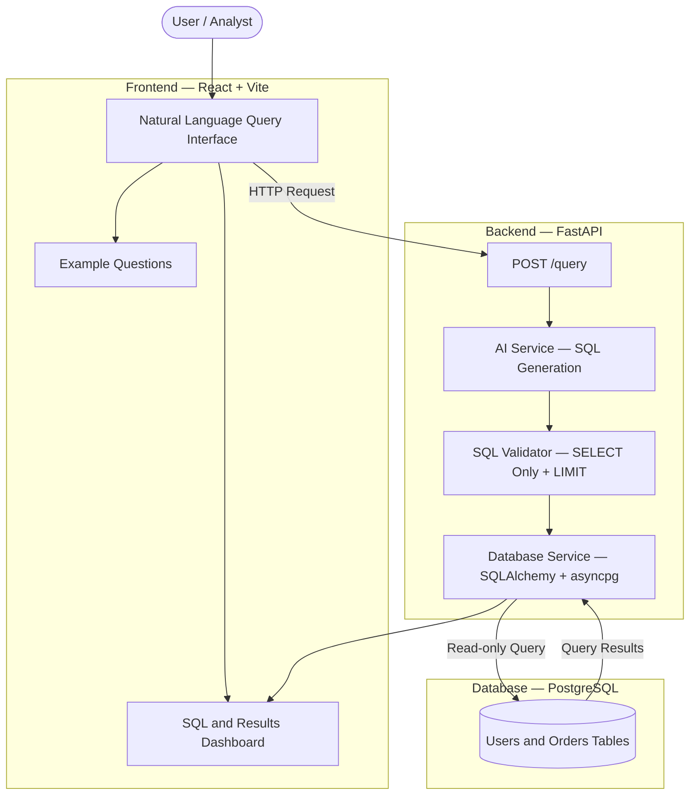

# 🤖 AI-Based Natural Language Database Interaction System

<p align="left">
  
  
  
  
  
  
</p>

A full-stack **AI-powered natural-language database interaction system** that enables users to query relational databases using everyday English. It uses an AI model to generate PostgreSQL queries, validates the generated SQL before execution, and presents the results through an interactive React interface.

The system combines **natural-language processing, SQL validation, and database integration** to make data retrieval more accessible while restricting execution to approved read-only queries.


## 🏛️ System Architecture




## ✨ Key Features

- 💬 **Natural Language to SQL:** Ask questions about database records in plain English without writing SQL manually.
- 🧠 **AI-Powered Query Generation:** Uses an AI service to generate PostgreSQL queries based on the database schema.
- 🛡️ **SQL Query Validation:** Validates generated SQL before execution and restricts execution to permitted read-only queries.
- 📊 **Interactive Results Table:** Displays query results in a structured table with column names and returned rows.
- ⚡ **Execution Metrics:** Shows the number of rows returned and query execution time.
- 🗄️ **Schema-Aware Processing:** Uses database schema information to help generate relevant SQL queries.
- 🐳 **Docker-Based Setup:** Uses Docker Compose to simplify local application and database setup.
- 🔌 **REST API:** Provides a FastAPI endpoint for submitting natural-language questions and receiving query results.
  

## 💻 Tech Stack

| Layer | Technologies | Purpose |
|---|---|---|
| Frontend | React, Vite, JavaScript, CSS | User interface and query results |
| Backend | Python, FastAPI | Request handling and API endpoints |
| AI Integration | OpenAI-compatible chat completions API | Natural-language-to-SQL generation |
| Database | PostgreSQL 16 | Relational data storage and querying |
| Database Access | SQLAlchemy Async, asyncpg | Asynchronous database connectivity |
| SQL Validation | SQLGlot | SQL parsing and query validation |
| Testing | pytest | Backend and SQL validation tests |
| DevOps | Docker, Docker Compose | Local environment and service orchestration |


## 📁 Project Structure

```text
AI-Based-Natural-Language-Database-Interaction-System/
├── backend/
│   ├── app/
│   │   ├── api/
│   │   │   └── routes/
│   │   │       └── query.py          # Natural-language query API
│   │   ├── core/
│   │   │   ├── config.py             # Application configuration
│   │   │   └── logging.py            # Logging setup
│   │   ├── schemas/
│   │   │   └── query.py              # Request and response schemas
│   │   ├── services/
│   │   │   ├── ai_service.py         # AI-powered SQL generation
│   │   │   ├── db_service.py         # Database access and schema lookup
│   │   │   └── sql_validator.py      # SQL validation and safety checks
│   │   └── main.py                   # FastAPI application entry point
│   ├── sql/
│   │   └── init.sql                  # Database schema and sample data
│   ├── tests/
│   │   ├── test_query_api.py         # Query API tests
│   │   └── test_sql_validator.py     # SQL validator tests
│   ├── .env.example                  # Backend environment template
│   ├── pytest.ini                    # Pytest configuration
│   └── requirements.txt              # Python dependencies
├── frontend/
│   ├── src/
│   │   ├── components/
│   │   │   ├── QueryComposer.jsx     # Natural-language query input
│   │   │   ├── ResultsTable.jsx      # Query results table
│   │   │   └── SqlPanel.jsx          # Generated SQL display
│   │   ├── pages/
│   │   │   └── App.jsx               # Main application interface
│   │   ├── services/
│   │   │   └── api.js                # Backend API integration
│   │   ├── main.jsx                  # React entry point
│   │   └── styles.css                # Application styling
│   ├── .env.example                  # Frontend environment template
│   ├── index.html                    # Browser entry page
│   ├── package.json                  # Frontend dependencies
│   └── package-lock.json             # Dependency lockfile
├── docs/
│   └── images/                       # Application screenshots
├── scripts/
│   └── dev.sh                        # Development startup script
├── docker-compose.yml                # Service orchestration
├── .gitignore                        # Git exclusions
└── README.md                         # Project documentation
```


## 🚀 Getting Started

### Prerequisites

- [Docker](https://www.docker.com/) with Docker Compose

### Step 1: Clone the Repository

```bash
git clone https://github.com/syafreen/AI-Based-Natural-Language-Database-Interaction-System.git
cd AI-Based-Natural-Language-Database-Interaction-System
```

### Step 2: Configure Environment Variables

Create local environment files using the provided templates:

```bash
cp backend/.env.example backend/.env
cp frontend/.env.example frontend/.env
```

Configure the required values in these files according to the example templates. Keep API keys, database passwords, and other secrets private.

### Step 3: Start the Application

If your Docker Compose configuration defines all required services, build and start them with:

```bash
docker compose up --build
```

## 🌐 Application Access

Once the application is running, access the services using the host and ports configured in `docker-compose.yml`.

| Service | Description |
|---|---|
| React + Vite Frontend | Natural-language query interface and results display |
| FastAPI Backend | REST API for query generation and execution |
| FastAPI `/docs` | Interactive API documentation, if enabled |
| PostgreSQL | Relational database used to store and query sample data |

## 💬 Example Queries to Try

Try asking natural-language questions about the sample `users` and `orders` tables.

### 📊 Orders and Revenue

- Show all orders with customer names and emails.
- Count orders by status.
- Show total revenue in dollars.
- Which users have the highest order totals?

### 👥 Customer Insights

- Show all users.
- List each user with their total spending.
- Show the latest paid orders with customer emails.

## 🔐 Security and Query Validation

The application uses a validation layer between AI-generated SQL and database execution.

- **Read-only queries:** The validator restricts permitted queries to `SELECT` statements.
- **SQL validation:** Generated SQL is checked before execution.
- **Result limits:** Query results are bounded to help prevent excessively large responses.
- **Database execution controls:** The documented backend design includes read-only transactions and statement timeouts.

These controls reduce risk but do not guarantee complete security. Production deployments should also use a dedicated read-only database account, authentication, access controls, and secure secret management.

## 👩‍💻 Author

**Afreen**

GitHub: [@syafreen](https://github.com/syafreen)
